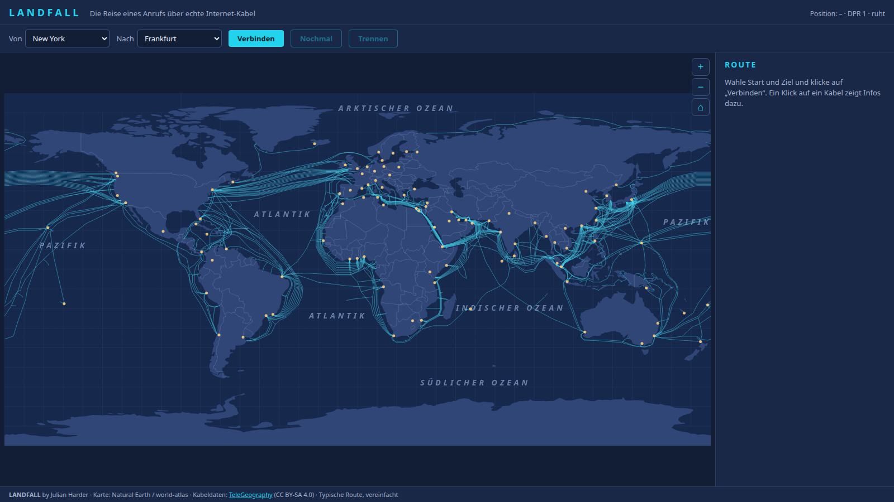
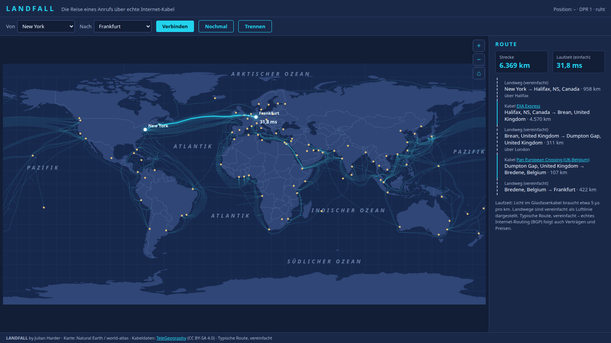
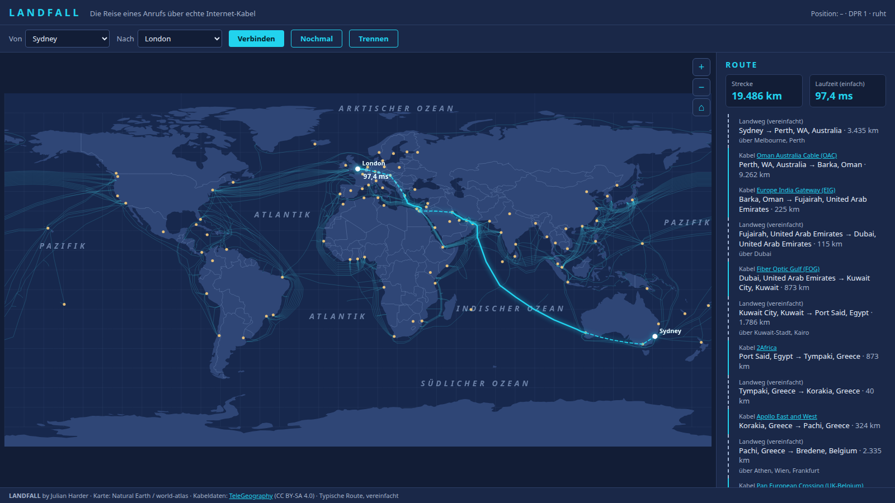
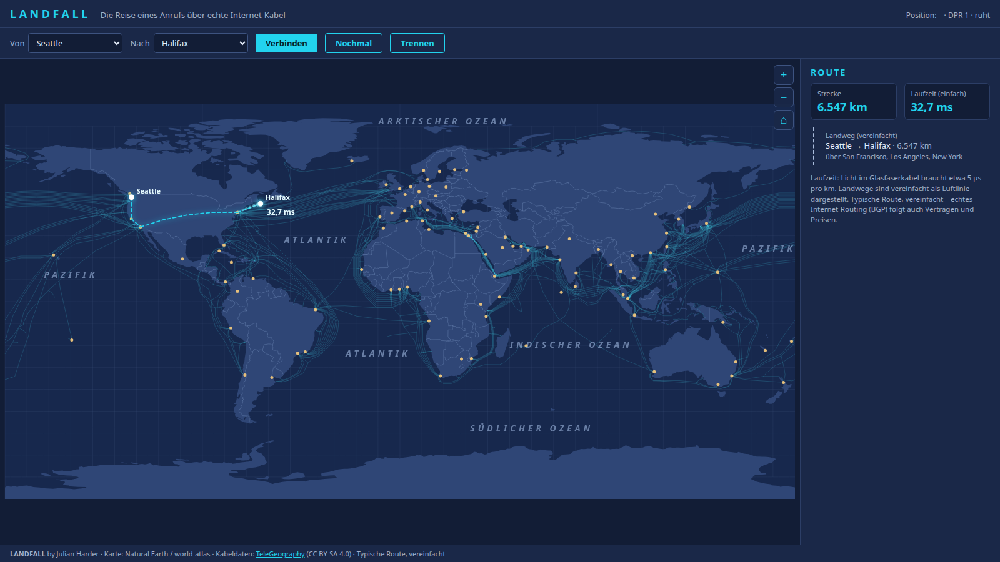
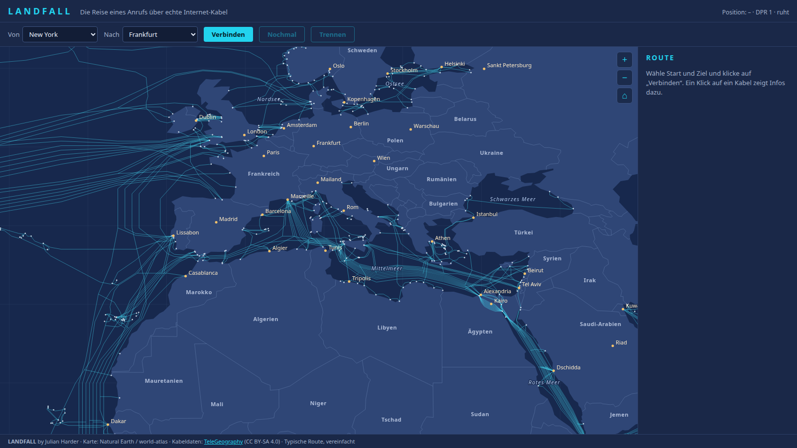
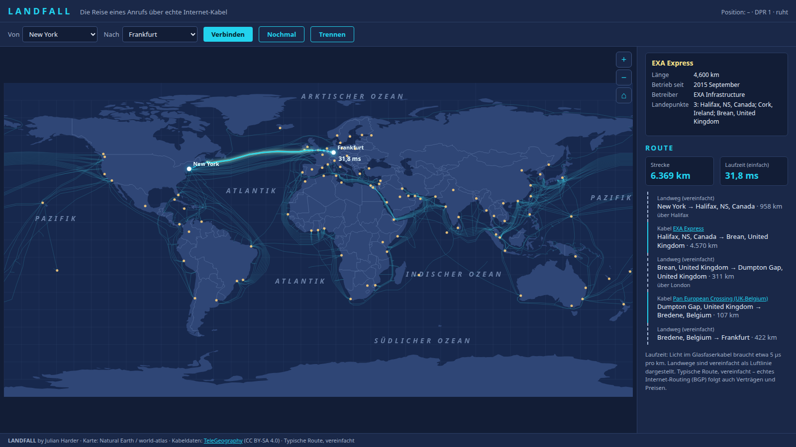
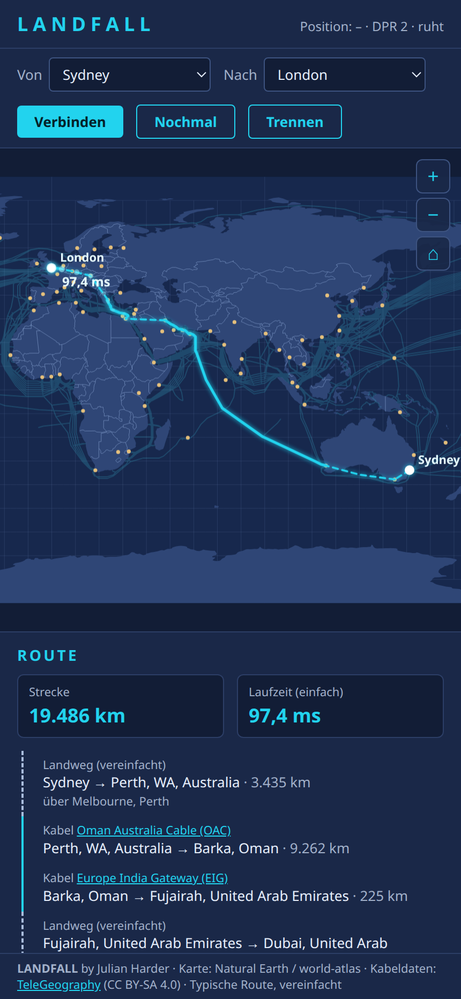

# LANDFALL – Die Reise eines Anrufs

Eine Weltkarte, auf der ein Anruf (oder ein Datenpaket) von einer Stadt zur anderen
**über echte Unterseekabel** läuft. Man wählt Start und Ziel, die Seite sucht den
kürzesten Weg über das Kabelnetz, zeigt ihn mit Kilometern und Laufzeit an und lässt
ein leuchtendes Paket die Strecke entlangfliegen.



> **Mit KI erstellt.** Dieses Projekt ist ein privates Lernprojekt, das ich zusammen mit der
> KI **Claude (Anthropic)** gebaut habe. Die Idee, die Anforderungen und alle Entscheidungen
> stammen von mir; den Code, die Daten-Skripte und diese Dokumentation hat die KI
> geschrieben und im Gespräch Schritt für Schritt überarbeitet. Mehr dazu [am Ende](#mit-ki-erstellt).

## Inhalt

- [Loslegen](#loslegen)
- [Was es kann](#was-es-kann)
- [Bilder](#bilder)
- [So funktioniert es](#so-funktioniert-es)
- [Was vereinfacht ist](#was-vereinfacht-ist)
- [Aufbau](#aufbau)
- [Werkzeuge und Tests](#werkzeuge-und-tests)
- [Wichtige Entscheidungen](#wichtige-entscheidungen)
- [Daten und Lizenz](#daten-und-lizenz)
- [Mit KI erstellt](#mit-ki-erstellt)

## Loslegen

`index.html` doppelklicken. Mehr ist nicht nötig: kein Server, kein Build, keine
Installation, kein CDN. Alle Bibliotheken und Daten liegen im Ordner.

Wer lieber über HTTP testen will:

```bash
python3 -m http.server 8765
# dann http://localhost:8765/index.html öffnen
```

Gebraucht wird ein aktueller Browser (Chrome, Firefox, Edge). Die Karte läuft mit
**Canvas 2D**, WebGL ist nicht nötig.

## Was es kann

| | |
| --- | --- |
| **Route berechnen** | Start und Ziel aus 101 Städten wählen (alphabetisch, deutsche Sortierung) und auf „Verbinden“ klicken. Oder direkt auf der Karte zwei Städte anklicken: der erste Klick ist der Start, der zweite das Ziel. |
| **Paket fliegen lassen** | Ein leuchtender Punkt mit Schweif läuft in 6 Sekunden die ganze Route entlang, daneben läuft die Laufzeit in Millisekunden mit. „Nochmal“ spielt ihn erneut ab, „Trennen“ blendet die Verbindung aus. |
| **Etappenliste** | Welche Kabel, welche Landwege, wie viele Kilometer. Landwege nennen die Städte dazwischen („über San Francisco, Los Angeles, New York“). |
| **Kabelinfo** | Ein Klick auf ein Kabel (auf der Karte oder in der Etappenliste) zeigt Länge, Betriebsbeginn, Betreiber und Landepunkte. |
| **Zoomen und Verschieben** | Mausrad zum Mauszeiger, Ziehen, Zwei-Finger-Kneifen, Tasten + / − / ⌂. Bis 40-fach. |
| **Beschriftung nach Zoom** | Ozeane und Meere (deutsch), Länder, Städte und Landepunkte erscheinen erst, wenn man hineinzoomt. Ein Ländername steht nur, wenn er **ganz ins Land passt**. |
| **Handy und schmale Fenster** | Im Hochformat füllt die Karte die Fläche und lässt sich verschieben. Nach „Verbinden“ holt die Karte die Route ins Bild. |

## Bilder

**Eine Route: New York → Frankfurt.** Das Paket ist unterwegs, die übrigen Kabel treten
zurück, damit die Route im Vordergrund steht. Rechts stehen Strecke, Laufzeit und alle
Etappen.



**Ein langer Weg: Sydney → London.** Quer durch Australien über Land, dann mit dem Kabel
OAC nach Oman, weiter über Land und mehrere Kabel nach Europa. Gestrichelt sind die
vereinfachten Landwege, durchgezogen die Kabel.



**Über Land statt über den Atlantik: Seattle → Halifax.** Ohne Landnetz lief diese Route
zweimal über den Atlantik (16.069 km). Mit dem Landnetz sind es 6.547 km, und das Paket
fliegt genau auf dem gebogenen Landweg.



**Hineingezoomt auf Europa.** Länder, Meere, Städte und Landepunkte sind beschriftet. Die
Namen erscheinen nur dort, wo sie vollständig ins Land beziehungsweise Meer passen.



**Kabelinfo.** Ein Klick auf ein Kabel zeigt seine Daten und hebt es auf der Karte hervor.



**Auf dem Handy.** Im Hochformat füllt die Karte die Fläche, die Route wird ins Bild geholt.



*(Alle Bilder sind Screenshots der echten Seite, aufgenommen mit kopflosem Chrome.)*

## So funktioniert es

### 1. Die Daten

- **467 Unterseekabel** und **1.438 Landepunkte** (die Küstenorte, an denen ein Kabel an
  Land geht) aus der öffentlichen Karte von TeleGeography. Zusammen sind das rund
  1,5 Millionen Kabelkilometer (nur die 436 Kabel mit Längenangabe gezählt).
- **101 Städte** mit Koordinaten, jeweils mit den Ländern, deren Landepunkte sie erreichen
  dürfen, und einem Anschlussradius.
- Länder aus Natural Earth (`world-atlas`, 110m).

### 2. Der Graph

Aus den Daten wird ein Graph mit **4.531 Knoten** (1.438 Landepunkte, 2.992 Kabelknoten,
101 Städte) und **7.201 Kanten** (4.797 Kabel, 2.404 Land) gebaut:

- **Kabelkanten** entstehen aus den Endpunkten der Linienstücke eines Kabels, nicht aus
  der Reihenfolge der Landepunkte in den Daten. Ein Kabel darf nur an Landepunkten
  gewechselt werden.
- **Landkanten** (gestrichelt) verbinden
  - Landepunkte desselben Landes bis 60 km Abstand (Kabelwechsel in einer Küstenregion),
  - jede Stadt mit den Landepunkten im Umkreis (je nach Stadt 100 bis 1.600 km, nur in
    den dafür vorgesehenen Ländern),
  - Nachbarstädte über das **Landnetz** (siehe unten).
- Entfernungen sind Großkreis-Entfernungen (**Haversine**).

### 3. Das Landnetz

Kabel enden an der Küste, aber ein Anruf von Seattle nach Halifax läuft in Wirklichkeit
über Land. Ohne Landverbindungen suchte der Algorithmus deshalb Umwege übers Meer.
`tools/land-links.js` verbindet darum Nachbarstädte, **wenn ihre Luftlinie bis 2.000 km
(fast) ganz über Land verläuft** (geprüft gegen die Ländergrenzen), und dünnt das Netz
anschließend aus: Liegt eine dritte Stadt ungefähr dazwischen, läuft die Route über sie.
Das ergibt 72 Strecken; 16 weitere sind von Hand gesetzt, dort wo die grobe Küste der
Ländergrenzen eine echte Landstrecke nicht erkennt (US-Ostküste, Nordafrika, Ostsee …).

### 4. Der kürzeste Weg

**Dijkstra** mit einem **Binary Heap** als Warteschlange, Kantengewicht = Länge in km.
Eine Route ist in wenigen Millisekunden berechnet (Sydney–London: rund 5 ms in Node). Aus den Kanten werden dann die
Etappen für die Liste gebildet (aufeinanderfolgende Landwege werden zusammengefasst) und
die Linie für die Karte.

### 5. Die Laufzeit

Licht im Glasfaserkabel schafft etwa 200.000 km/s, das sind **5 µs pro Kilometer**.
Aus der Strecke folgt die Mindestlaufzeit der einfachen Strecke, zum Beispiel
6.369 km ≈ 31,8 ms. Gerätezeiten und Wartezeiten sind darin nicht enthalten.

### 6. Das Zeichnen

- **Zwei Canvas-Schichten.** Der Hintergrund (Länder, Kabel, Städte, Beschriftung) wird
  nur bei Größen- oder Ansichtsänderung neu gezeichnet (4 bis 6 ms). Der Vordergrund
  (Route, Paket, Hover) läuft mit höchstens 30 FPS und **nur, solange etwas animiert
  wird**; im Ruhezustand wird nichts gezeichnet. Bei verstecktem Tab pausiert alles.
- **Zoom über die Zeichen-Transformation.** Die Geometrie wird einmal als `Path2D` erzeugt,
  Linienbreiten werden durch den Zoomfaktor geteilt, damit sie auf dem Bildschirm gleich
  bleiben.
- **Datumsgrenze:** d3-geo schneidet Linien bei 180° automatisch, deshalb entstehen keine
  waagerechten Streifen quer über die Karte.
- **Das Paket fliegt auf dem Großkreis**, genau wie d3 die Linie zeichnet. Sonst liefe der
  Punkt bei langen Landwegen geradeaus unter dem gebogenen Strich entlang.
- **Ruhige Karte:** Im Ruhezustand erscheinen nur die Fernkabel (ab 4.000 km, 105 von
  467). Kürzere Kabel, Landepunkte, Städtenamen und Ländernamen kommen erst beim
  Hineinzoomen. Mit aktiver Route treten alle anderen Kabel zurück.
- **Namen, die passen:** Ein Ländername wird nur gezeichnet, wenn sein ganzes Textfeld
  (mit Rand) im größten Landesteil liegt (Punkt-im-Polygon in Bildschirmpixeln) und keine
  Stadt verdeckt. Meere und Ozeane stehen an von Hand gesetzten Positionen, kleine Meere
  erst bei stärkerem Zoom.
- **Hochformat:** Ist die Fläche schmaler als 1,2 : 1, füllt die Karte sie aus; die
  Detailstufen richten sich nach dem Zoom relativ zur Grundansicht, damit es auf dem Handy
  so ruhig ist wie am Desktop.

## Was vereinfacht ist

LANDFALL ist ein Lernprojekt und sagt das auch auf der Seite („Typische Route,
vereinfacht“). Wichtig zu wissen:

- **Die Route ist der kürzeste Weg über das Netz, nicht der echte Weg.** Das Internet
  wählt Wege per **BGP** nach Verträgen, Preisen und Auslastung. Ein Anbieter schickt
  Daten oft über „seine“ Kabel, auch wenn ein anderes kürzer wäre. Hin- und Rückweg
  unterscheiden sich in der Praxis oft, und ein Anruf besteht aus vielen Paketen, die
  verschiedene Wege nehmen können.
- **Landwege sind Luftlinie.** Echte Glasfaserstrecken sind länger und verlaufen nicht
  gerade. Die Laufzeit der Landwege ist deshalb etwas zu kurz.
- **Die Laufzeit ist die einfache Strecke** ohne Geräte, Warteschlangen und Verarbeitung.
- **Die Karte ist aufgeräumt:** Kabel unter 100 km und Inselnetze ohne Anschluss ans
  Hauptnetz sind entfernt (607 → 467 Kabel). Alle 101 Städte bleiben verbunden.
- **Städte sind Punkte, keine Rechenzentren.** Eine Stadt hängt an allen Landepunkten
  im Umkreis, nicht an einem bestimmten Anschlusspunkt.
- **Wo es kaum Kabel gibt, bleiben Umwege.** Nach dem Gesamttest haben 7 von 5.050
  Städtepaaren (unter 6.000 km Luftlinie) eine Route über 2,5-mal so lang wie die
  Luftlinie: Havanna–Miami (kein Kabel für den normalen Verkehr), Seoul–Wladiwostok
  (das Kabel fehlt in den Daten), Mauritius zu Malediven, Somalia, Tansania und Sri Lanka,
  Lagos–Dschidda (Westafrika nach Arabien läuft über Europa).
- **Getestet** ist die Seite in Chrome, auch per Doppelklick (`file://`) und in schmalen Fenstern. **Nicht getestet** sind das echte Handy (Touch, Pinch), Firefox und Safari sowie die Last im Task-Manager.

## Aufbau

```
index.html, style.css
README.md, LICENSE
FORTSCHRITT.md          Stand, Entscheidungen, was getestet ist
LANDFALL-Plan.md        der ursprüngliche Plan mit den sieben Etappen
screenshots/            Bilder für diese README
js/
  graph.js              Graph, Haversine, Landverbindungen
  dijkstra.js           kürzester Weg (Binary Heap), Etappenliste
  map.js                Projektion, Zoom/Verschieben, Zeichnen, Route, Treffer
  labels.js             Namen von Meeren und Ländern
  animation.js          Zeichenschleife (30 FPS, Pause im Hintergrund), Paket
  ui.js                 Dropdowns, Infoleiste, Kabel-Infokarte
  main.js               Start, Events (Zeiger, Rad, Klicks), Verbindung
data/
  cables.js, landings.js   Kabel und Landepunkte (TeleGeography, aufgeräumt)
  cities.js                101 Städte, Anschlussradien, handgesetzte Landstrecken
  landlinks.js             Landstrecken zwischen Nachbarstädten (erzeugt)
  names.js                 deutsche Ländernamen und Meeresliste
  countries.js             Länder (Natural Earth über world-atlas, 110m)
lib/                       d3-array, d3-geo, topojson-client (lokal, kein CDN)
tools/
  prune-data.js            räumt die Kabeldaten auf
  land-links.js            erzeugt data/landlinks.js aus den Ländergrenzen
  test-routes.js           Gesamttest aller Städtepaare
  in-portfolio-kopieren.sh kopiert die Seite ins Portfolio
```

**Daten als `.js`:** Die Daten stehen als `window.CABLES = …` in `.js`-Dateien, nicht als
JSON. Grund: Die Seite soll per Doppelklick über `file://` laufen, und Browser blockieren
dort `fetch` und ES-Module. Deshalb gibt es auch kein `import`/`export`, sondern
klassische `<script>`-Tags in fester Reihenfolge.

## Werkzeuge und Tests

Alle Skripte brauchen nur Node.js (kein `npm install`).

```bash
# Gesamttest: alle 5.050 Städtepaare, beide Richtungen (dauert etwa 85 Sekunden)
node tools/test-routes.js
UMWEG=1.8 node tools/test-routes.js     # mehr Umwege auflisten

# Landnetz neu erzeugen (MAX_KM, MAX_SEA einstellbar)
node tools/land-links.js

# Kabeldaten aufräumen (rechnet von data/_voll/ aus, siehe unten)
MIN_KM=50 node tools/prune-data.js
```

Der **Gesamttest** prüft für jedes Paar, ob eine Route existiert, ob Start und Ziel stimmen,
ob die Strecke mindestens so lang ist wie die Luftlinie, ob die Laufzeit zur Strecke passt
(5 µs/km), ob Hin- und Rückweg gleich lang sind, ob die Etappen die Gesamtstrecke ergeben
und eine lückenlose Kette bilden und ob die Linie auf der Karte keine Lücken hat. Dazu
kommen Datenprüfungen (doppelte IDs, Städte ohne Verbindung, ein zusammenhängendes Netz).
Aktueller Stand: **0 harte Fehler**, dazu die oben genannten Hinweise auf auffällige
Umwege. Der Test hat unter anderem einen unsauberen „Landweg · 0 km“ in der Etappenliste und
drei zu kleine Anschlussradien (Tokio, Seoul, Chennai) gefunden.

Das ersetzt keinen Blick auf die Karte: Der Test prüft Rechnung und Daten, nicht, ob
jede Route der Wirklichkeit entspricht.

## Wichtige Entscheidungen

- **Kein Kappen-Szenario.** „Kabel kappen“, „Rotes Meer sperren“ und „Atlantik kappen“ waren
  gebaut und sind auf Wunsch wieder entfernt worden.
- **Übersichtlichkeit vor Vollständigkeit.** Kurze Kabel und Inselnetze sind herausgefiltert,
  im Ruhezustand sind nur Fernkabel zu sehen.
- **Hell genug für einen hellen Raum.** Das Design ist dunkel, aber bewusst aufgehellt, damit
  die Karte auch bei Spiegelungen lesbar bleibt.
- **Realistische Routen vor einfachem Algorithmus.** Unrealistische Strecken wurden nicht
  durch zusätzliche Regeln im Algorithmus behoben, sondern durch fehlende Daten
  (Landnetz, Anschlussradien).

Die ausführliche Geschichte mit allen Etappen und Messwerten steht in
[`FORTSCHRITT.md`](FORTSCHRITT.md), der ursprüngliche Plan in
[`LANDFALL-Plan.md`](LANDFALL-Plan.md).

## Daten und Lizenz

- **Quellcode** (`index.html`, `style.css`, `js/`, `tools/`) und Dokumentation:
  [MIT-Lizenz](LICENSE).
- **Kabeldaten** (`data/cables.js`, `data/landings.js`): Quelle ist die öffentliche Karte
  von **[TeleGeography](https://www.submarinecablemap.com)** (Submarine Cable Map). Laut
  TeleGeography stehen die Karten unter **CC BY-SA 4.0**, die Namensnennung ist Pflicht
  (sie steht in der Fußzeile der Seite). Die **Rohdaten** der Kabel-Datenbank bietet
  TeleGeography dagegen als kostenpflichtiges Produkt an. Die hier liegenden Dateien sind
  eine aufgeräumte Auswahl der Daten, die die öffentliche Karte ausliefert. Es gelten die
  Bedingungen von TeleGeography; **wer die Daten weiterverwenden will, muss das selbst
  klären.** Die ungekürzten Daten (`data/_voll/`) liegen aus diesem Grund nicht im
  Repository.
- **Länder** (`data/countries.js`): Natural Earth (Public Domain) über das npm-Paket
  `world-atlas`.
- **Bibliotheken** (`lib/`): [d3-array](https://github.com/d3/d3-array),
  [d3-geo](https://github.com/d3/d3-geo) und
  [topojson-client](https://github.com/topojson/topojson-client), jeweils unter
  ihrer eigenen Open-Source-Lizenz (Lizenztext im jeweiligen Projekt, Copyright-Hinweis
  im Dateikopf).

## Mit KI erstellt

Dieses Projekt ist ein **privates Lernprojekt**, das ich zusammen mit der KI **Claude** von
Anthropic gebaut habe.

- **Von mir:** die Idee, der Plan, die Wünsche (zum Beispiel „Karte übersichtlich halten“,
  „heller“, „Länder nur, wenn der Name hineinpasst“), das Ausprobieren und alle
  Entscheidungen darüber, was bleibt und was wieder rausfliegt.
- **Von der KI:** der Code, die Daten-Skripte, die Tests, die Screenshots und diese
  Dokumentation. Sie wurden im Gespräch Schritt für Schritt geschrieben, im Browser
  ausprobiert und überarbeitet.

KI-Code kann Fehler enthalten. Darum gibt es den Gesamttest, und darum steht oben, was
vereinfacht ist. Wer etwas Falsches findet, kann gern ein Issue anlegen.

---

**LANDFALL by Julian Harder** · 2026
